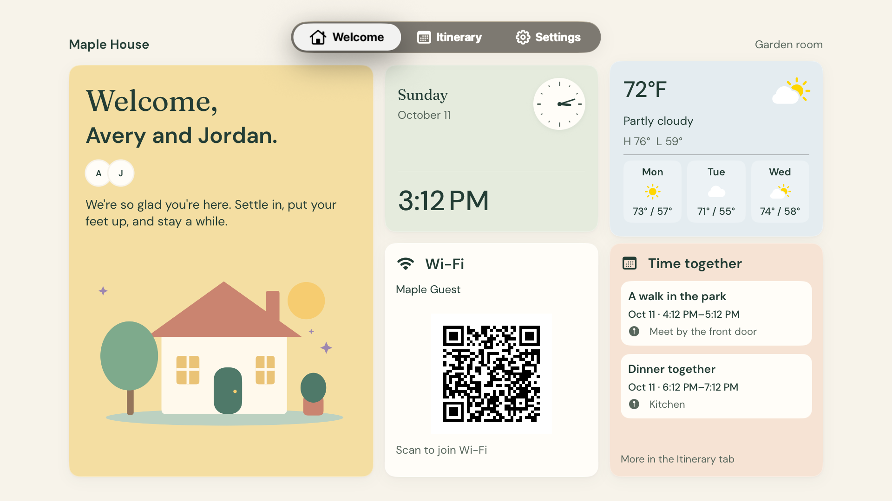
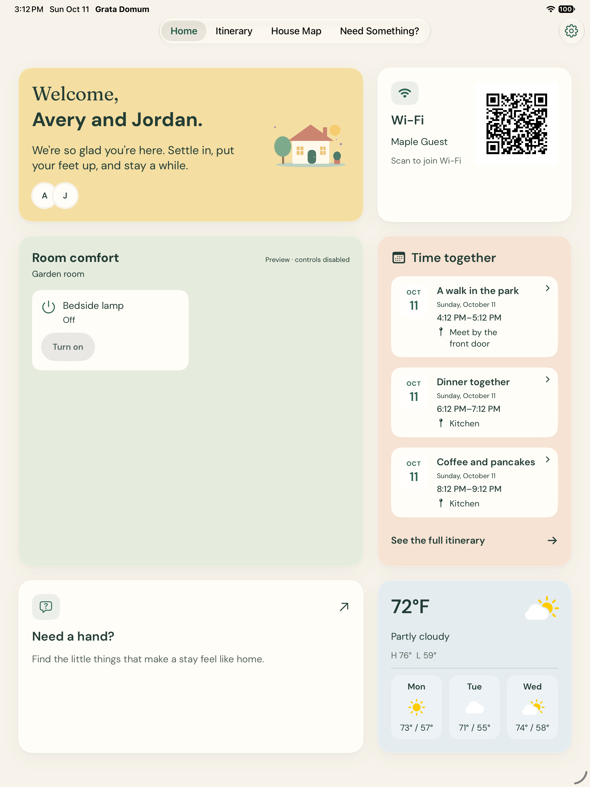
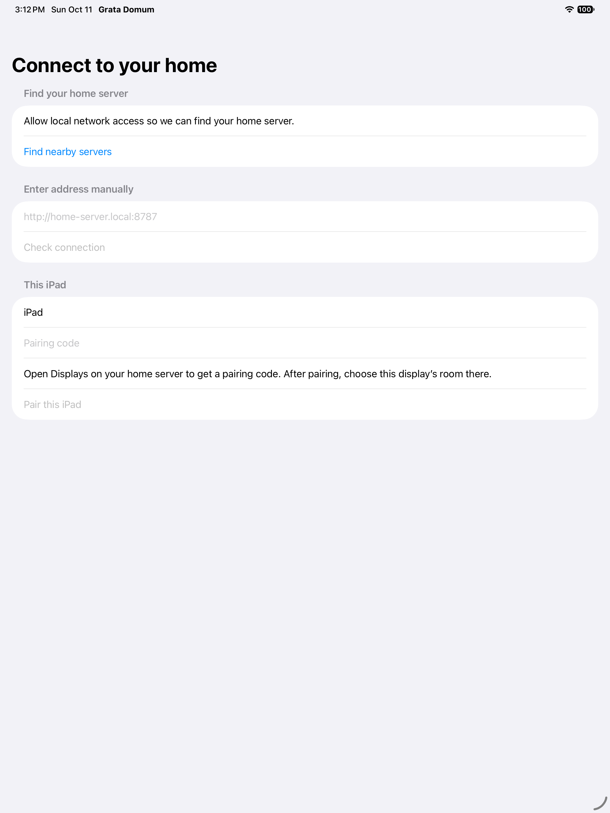

# Grata Domum

**A self-hosted welcome book for your house guests.**

Give visitors a personal welcome, Wi-Fi details, daily plans and answers to the little questions that make a stay comfortable. Native SwiftUI apps serve iPad and Apple TV; a Next.js server gives hosts one place to prepare the visit.



| iPad welcome | Find your home server |
| --- | --- |
|  |  |

Screenshots are actual simulator renders with fictional household data. [Capture details](docs/screenshots/README.md).

## What it does

- **Prepare a visit:** guest names, photos, welcome message, scheduled plans, seasonal themes and an inert preview before saving.
- **Help guests settle in:** Wi-Fi QR, house guide, map pins, weather and a shared notes board.
- **Keep controls local:** optional Home Assistant shortcuts limited to the iPad’s assigned room. Apple TV stays read-only.
- **Connect displays simply:** Bonjour discovery, a connection check and single-use host pairing codes, with manual entry for networks that block multicast.
- **Handle interruptions:** native cached content, reconnect handling and retryable notes. Physical controls are never queued or replayed.

The iPad has Home, Itinerary, House Map and Need Something?. Apple TV has Welcome, Itinerary and Settings. Host management stays in the browser.

## Status

An active personal project, ready for local development and evaluation. Automated server/shared-client tests and simulator builds are exercised; physical-device installation, LAN permission prompts, TV remote focus, real QR scanning and overnight operation still need validation. There is no App Store release or turnkey container image. See [verification and remaining checks](docs/verification.md).

## Run the server

Use **Node.js ≥22.13** and npm. Node 22.19.0 is the local verification baseline. SQLite is built into Node and currently runs with its experimental flag, configured by the scripts.

```sh
git clone https://github.com/seanpwelch90/grata-domum.git
cd grata-domum
npm ci
# Choose an absolute private path outside the checkout.
export GRATA_DATA=/absolute/private/path/to/grata-data
npm run build
node scripts/serve-with-discovery.mjs
```

Open [localhost:8787](http://localhost:8787) on the server. First use asks for a household name and a host password of at least eight characters. Create a visit, add any optional house information, then generate a code under **Displays**.

For development, use `node scripts/serve-with-discovery.mjs --dev`. `npm run dev` and `npm start` also work with manual server addresses. Bonjour uses macOS’s `dns-sd` or Linux’s `avahi-publish-service`; missing discovery tools leave manual entry available. [Discovery, containers and reverse proxies](docs/operations/discovery.md).

The server listens on the LAN. Keep it on a trusted network; the default HTTP transport is unencrypted. Public source availability does not make this an internet-facing service. Household data, Wi-Fi details, tokens and backups belong outside Git. [Deployment and backup/restore](docs/operations/server.md).

## Run the native apps

On a Mac with Xcode and compatible SDKs, open `clients/GrataDomum.xcodeproj`:

1. Choose **Grata Domum** for iPad or **Grata Domum TV** for Apple TV. Targets require iPadOS/tvOS 18 or later.
2. For physical devices, select your own developer team and signing configuration.
3. Launch the app, allow local-network access, choose **Find nearby servers** or enter the server’s LAN URL, then check the connection.
4. Enter the host’s pairing code and a display name. Assign its room in the host console.

A physical display cannot use `localhost` to reach another machine. Networks with guest isolation or separate VLANs may need manual entry and an intentionally configured route. [Native installation and operation](docs/operations/native.md).

Browser display fallbacks are also available at `/display` and `/tv`.

## Develop and verify

```sh
npm test
npm run typecheck
npm run lint
npm run format:check
npm run swift:lint
(cd clients/GrataDomumKit && swift test)
```

Use a temporary `GRATA_DATA` for test servers. Tests create isolated databases; never copy a real household database into fixtures. Do not run a Next build and development server against the same `.next` directory at once.

| Path | Responsibility |
| --- | --- |
| `app/`, `components/` | Next.js routes, host workspace and browser guest UI |
| `lib/` | Authentication, SQLite, visits, snapshots, weather and HA integration |
| `clients/iPad/`, `clients/AppleTV/` | Native guest apps |
| `clients/GrataDomumKit/` | Shared models, transport, cache, session and onboarding |
| `contracts/` | Fictional cross-platform fixtures and shared design tokens |
| `docs/operations/` | Discovery, installation, deployment and recovery |

Built-in palettes are generated from `contracts/design-tokens.json`; run `node scripts/generate-design-tokens.mjs` after editing them. [Contributor guidance](AGENTS.md) covers behavior and validation expectations.

## Assets and licensing

The public checkout bundles original house illustrations and local Fraunces/DM Sans fonts. The fonts retain their SIL Open Font License notices. [Third-party notices](THIRD_PARTY_NOTICES.md).

No project-wide reuse license has been granted yet. Third-party assets retain their own licenses. This public snapshot omits private planning references, household data and artwork that cannot be redistributed.
